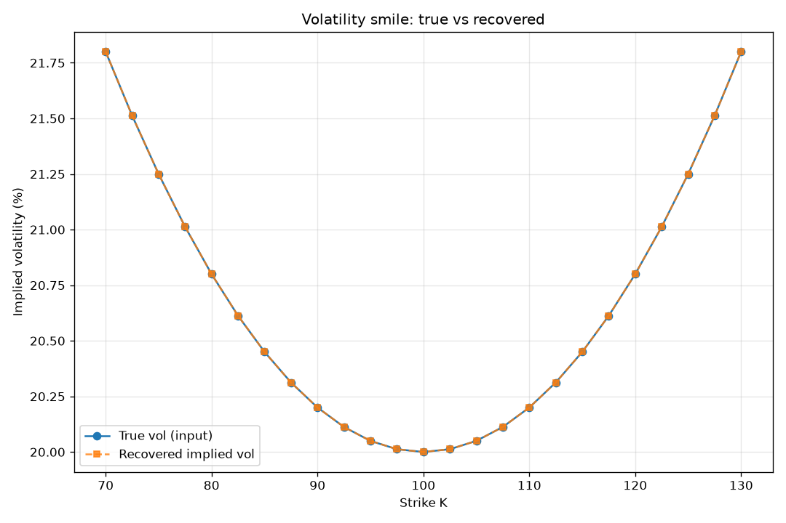

# Implied-volatility solver

Recover Black–Scholes implied volatility from European option prices using Newton–Raphson with a bracketed Brent fallback.

**The reproduced synthetic smile has maximum absolute volatility error 6.20 × 10⁻¹⁰ across 25 strikes.** This is a controlled round trip, not market calibration.



## Quick start

From the repository root; no external data are needed:

```bash
python3 -m venv .venv
.venv/bin/pip install -r requirements-dev.txt
.venv/bin/python -m pytest -q
```

`python -m src.solver` prints known-volatility examples. `python -m src.make_figure` regenerates the figures and [saved smile inputs and outputs](results/smile.json).

## Method

- Black–Scholes call and put pricing with analytic vega.
- Newton updates divide the price residual by vega.
- Small vega, invalid updates or nonconvergence trigger the Brent fallback.
- Brent solves within a volatility bracket and reports convergence status.
- Results expose volatility, price residual, iterations and method.

## Results

| Controlled check | Evidence |
|---|---|
| Synthetic-smile round trip | Maximum absolute error 6.20 × 10⁻¹⁰ |
| Known-volatility tests | Absolute tolerance 10⁻⁶ |
| Deep out-of-the-money Brent test | Absolute tolerance 10⁻⁴ |

The smile uses model-generated prices and explicit inputs saved alongside the figure. The test tolerances describe those cases, not a guarantee for arbitrary quotes.

## What didn't work

Newton can fail when vega becomes small; the bracketed fallback handles the tested edge cases. The implementation covers vanilla European options under flat Black–Scholes assumptions. Dividends, quote cleaning, surface fitting and a benchmark against other solvers are absent. Previous alternative-solver iteration and adoption claims lacked evidence and were removed.

## Tests, structure and licence

[](https://github.com/VChahar1/implied-vol-solver/actions/workflows/tests.yml)

All 18 tests pass, including parity, vega, solver round trips and fallback cases. `src/bs.py` prices options, `src/solver.py` inverts prices, and `src/make_figure.py` produces diagnostics. `notebooks/01_implied_vol_solver.ipynb` retains its saved outputs; generated checkpoints are excluded. Code: [MIT](LICENSE).
